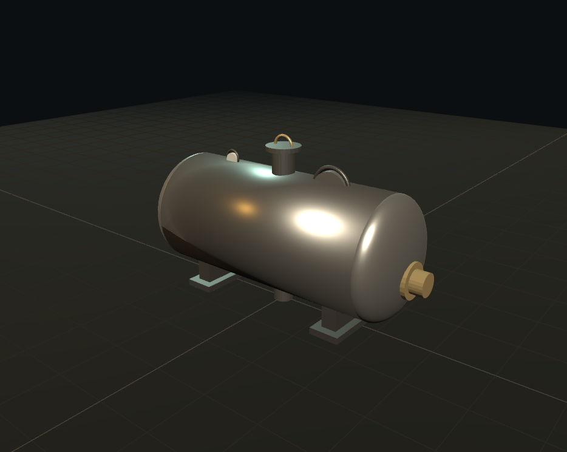

# GLB 管线 spike：三相分离器

日期：2026-11-21 · 目的：在批量做 Blender 资产前，验证「Blender 导出 → 浏览器加载 → 渲染/性能」整条链路。

## 1. 做法

- 资产：`tools/spike_separator.py`（bpy 程序化），包含筒体、椭圆封头、鞍座/底座、进出口接管与法兰、人孔、压力表、阀轮、梯子横档。
- 导出：GLB + OBJ/MTL + `.blend`，产物在 `web/assets/spike/`。
- 页面：`web/_spike-separator.html`（非生产页面），用 spike 专用 `assets/spike/glb-mini.js` 解析 GLB。
- 环境：本机 127.0.0.1:8779，Chrome headless（ego），1280 宽视口。

## 2. 资产数据（Blender 4.5.16 LTS 实测）

| 项 | 数值 |
|---|---|
三角面 | **10,412** |
顶点 | 5,252 |
mesh 对象 | 27 |
材质 | 5 |
GLB | **500 KB** |
OBJ | 698 KB |
.blend | 1.13 MB |
尺寸 | 5.2 m × 2.1 m × 2.9 m |

## 3. 运行时数据（真实运行，非估算）

| 指标 | 数值 | 说明 |
|---|---|---|
fetch | 70.2 ms | 本机 http.server，非公网 |
解析 | 1.2 ms | MiniGLB，10k 面 |
总加载到首帧 | **72 ms** | 不含首帧渲染 |
draw calls | **29** | 27 mesh + 地面/网格 |
三角面 | 10,412 | 与 Blender 统计一致 |
FPS | **未测** | headless 下 rAF 被节流（5 秒仅 6 帧），不能拿这个数当性能结论 |

## 4. 发现的问题（关键）

1. **现有 `three.browser.js` 没有导出 GLTFLoader / OBJLoader**。运行时实测 `THREE.GLTFLoader === undefined`，文件里的 “GLTFLoader” 只是注释文档。
2. 因此本 spike 用了自写的最小 GLB 解析器（`glb-mini.js`），只支持 POSITION/NORMAL/indices + PBR 基础色/金属度/粗糙度；**不支持贴图、骨骼、动画、Draco、交错顶点**。它只用于验证，不是生产方案。
3. 27 个 mesh 全部独立绘制（29 calls），生产资产需要**按材质合并**，目标 ≤ 8 calls/台。
4. 500 KB / 10k 面对单台设备可接受，但 5 台 hero 资产会到 ~2.5 MB；需要 LOD、合并、贴图压缩。

## 5. 结论（go / no-go）

- **Blender 生产管线：go**。脚本化建模、导出、面数/体积可控，视觉质量明显高于程序化几何（封头、鞍座、法兰、阀轮都能读出来）。
- **GLB 运行时：暂不 go**。缺官方 loader，最小解析器不支持材质贴图/压缩，直接上生产会在资产变复杂时崩。
- **近期推荐：Blender → OBJ + MTL**。塔页已经在用 OBJ，可把塔的解析器抽成共享模块；不新增 loader 依赖、不引 ESM/importmap。
- **中期可选：GLB**。需要先把官方 `GLTFLoader`（r180，MIT）以模块方式本地化，并做一次兼容验证，再切换。

## 6. 下一批资产规格（按 OBJ 输出）

| 资产 | 目标面数 | draw calls | 备注 |
|---|---|---|---|
三相分离器 | ≤ 12k | ≤ 8 | 合并同材质 |
抽油机 | ≤ 10k | ≤ 6 | 游梁/驴头/曲柄为轮廓重点 |
井口采油树 | ≤ 8k | ≤ 6 | 阀组、法兰、表 |
外浮顶罐 | ≤ 10k | ≤ 6 | 浮盘、密封圈、盘梯 |
加热炉 | ≤ 8k | ≤ 6 | 炉管、炉膛、烟道 |
