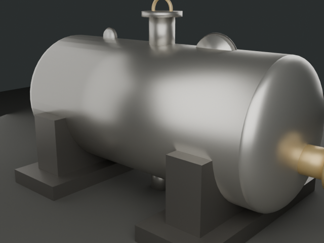
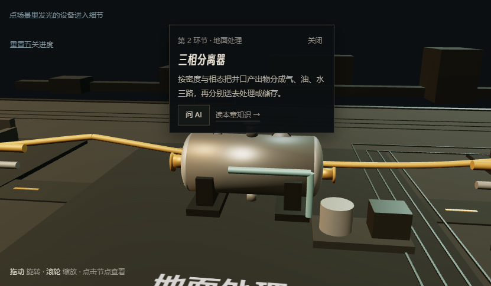

# Hero 资产 v1（Blender → OBJ/MTL）

日期：2026-11-22 · 生成脚本：`tools/make_hero_assets.py` · 输出：`web/assets/hero/<id>/`

目标：把沙盘里五台关键设备从 Three.js 程序化几何升级为 Blender 中模，按材质合并、控制 draw call，先用 OBJ 管线（不引新 loader）。

## 1. 资产清单（实测）

| 资产 | 三角面 | 合并后对象 | 材质 | OBJ | 预算 | 状态 |
|---|---|---|---|---|---|---|
三相分离器 `separator` | 8,236 | 5 | 5 | 452 KB | ≤12k / ≤8 calls | **接受 v1** |
抽油机 `pumpjack` | 1,208 | 4 | 4 | 66 KB | ≤10k / ≤6 calls | **需美术复审**（细节偏少） |
井口采油树 `wellhead` | 3,948 | 4 | 4 | 201 KB | ≤8k / ≤6 calls | **接受 v1** |
外浮顶罐 `floating_roof_tank` | 5,448 | 4 | 4 | 310 KB | ≤10k / ≤6 calls | **接受 v1** |
加热炉 `heater` | 1,364 | 4 | 4 | 65 KB | ≤8k / ≤6 calls | **需重做结构**（太像箱子） |

合计 26 个文件、2.69 MB（含 5 张 Cycles 预览）。全部在面数预算内，但“预算内”不等于质量达标。

## 2. 每个资产包含什么

- `separator`：筒体 + 椭圆封头 + 鞍座/底座 + 进出口/法兰 + 人孔 + 压力表 + 阀轮 + 梯档；锚点 inlet/outlet/gas/water。
- `pumpjack`：底座、A 架、游梁、驴头（弧形板 + 背板）、曲柄/配重、电机、桥式拉杆、走道；锚点 horsehead/beam/crank/motor。
- `wellhead`：底法兰、套管头、主阀、翼阀（两侧）、压力表、手轮；锚点 top/wing。
- `floating_roof_tank`：罐壁、罐底、浮盘/密封圈、导向杆、风圈、顶部平台、直梯、进出料、防火堤；锚点 deck/rim/inlet。
- `heater`：炉体、炉顶、烟囱、燃烧器、炉管（外露）、进出口集箱、平台、梯档；锚点 stack/outlet/burner。

每个目录还带：

```
<id>.obj / <id>.mtl      合并后的网格与材质
<id>.meta.json           尺寸、三角面、对象数、材质数、锚点、预算
<id>.stats.json          同上（工具读）
preview.png              Cycles CPU 预览（640×480，非应用内截图）
```

`web/assets/hero/index.json` 汇总五台资产。**未生成 .blend**（脚本即源，避免仓库膨胀；需要时用脚本重建）。

## 3. 预览

| 资产 | 预览 |
|---|---|
分离器 |  |
抽油机 |  |
井口 |  |
外浮顶罐 |  |
加热炉 |  |

预览暴露的问题（不掩盖）：

- 分离器封头比例已收，但鞍座仍是方块，缺加强筋/地脚螺栓；
- 抽油机驴头已连上游梁，但整机太“骨架”，缺平台、护栏、管线、铭牌；
- 加热炉仍像“箱子 + 烟囱”，炉管外露是教学取舍，但缺炉门、看火窗、风道；
- 井口/储罐在预览里材质偏亮，钢件对比度不足（预览灯光问题，不是资产问题）。

## 4. 材质与命名约定

材质名固定为 `Steel / LightSteel / DarkSteel / Amber / Gauge`，便于运行时映射到 `tokens.css`：

| 材质 | 用途 | 运行时建议 |
|---|---|---|
Steel | 筒体、塔体、主要钢结构 | `#9b968a`，metalness 0.8，roughness 0.42 |
LightSteel | 封头、游梁、平台 | `#cfc8ba`，metalness 0.7，roughness 0.4 |
DarkSteel | 鞍座、底座、栏杆 | `#3a3830`，metalness 0.6，roughness 0.6 |
Amber | 管线、阀轮、浮盘密封 | `#d8a24a`，metalness 0.4，roughness 0.45 |
Gauge | 表盘 | `#e8e1d4`，metalness 0.1，roughness 0.3 |

对象名格式：`<assetId>__<material>`，一个材质一个对象，直接对应一次 draw call。

## 5. 接入进度：分离器单台闭环（2026-11-22）

已把 `separator` 真正接进沙盘：

- 新增共享解析器 `web/assets/obj-lite.js`（v/vn/f、多边形三角化、o/g/usemtl、MTL Kd），只支持静态网格，不支持贴图/骨骼/压缩；
- `immersion.js` 的 `loadHeroSeparator()` 异步加载 `assets/hero/separator/separator.obj` + `.mtl`，加载成功后替换程序化分离器，失败保留程序化模型作为回退；
- 5 个材质对象（Steel/LightSteel/DarkSteel/Amber/Gauge），每个对象写入 `objectId=three_phase_separator`，点击可弹设备卡片；
- 实测：OBJ 8 ms、MTL 5 ms（本机），5 个 mesh，`selectStage('gather')` 后点击弹卡片「三相分离器」。



已知问题：进料/出料管线仍是程序化位置，与资产法兰不完全对齐；一根青色管线在画面上从筒体前穿过（遮挡，不是穿模）。其余四台尚未接入。

## 6. 接入其余四台的前置工作（未做）

1. **共享 OBJ 解析器**：塔页的 `parseOBJ` 目前内嵌在 `tower.js`，需要抽成 `assets/obj-lite.js` 或用本地化的 `OBJLoader`，否则每个页面复制一份解析器。
2. **材质映射**：OBJ 的 MTL 颜色 → `MeshStandardMaterial` → tokens 色值；现在是 Blender 里的颜色，接入时要统一。
3. **锚点注册**：`.meta.json` 的 anchors 要写进 `DEVICE_INFO`/`__sceneContext`，设备卡片与 AI 才知道每台设备的进料/出口。
4. **LOD 与合并**：OBJ 已经是按材质合并；还需要远/中/近三档或至少一个低模替代。
5. **摆放与朝向**：OBJ 导出为 Y-up、`-Z` 前向；接入时要按沙盘区域旋转、缩放、落地（现在脚本建模是 Z-up、米制）。

在这些完成前，沙盘仍使用程序化几何，不会出现“资产已上线”的假象。

## 7. 复现

```bash
blender -b -P tools/make_hero_assets.py -- --render
```

无 `--render` 时只导出 OBJ/MTL/meta/stats，不跑 Cycles。
