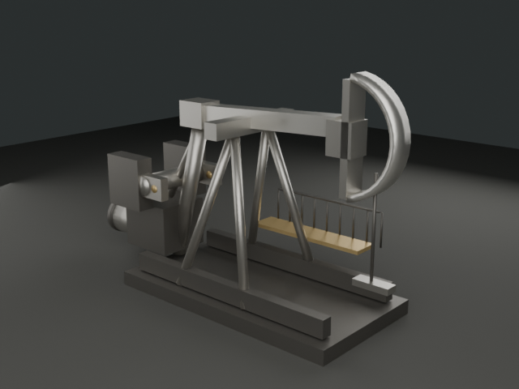
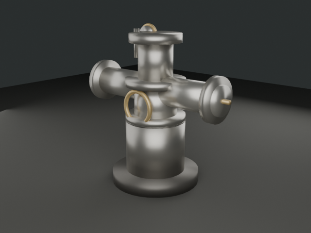
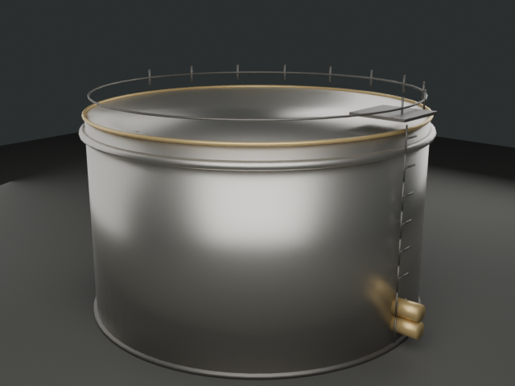
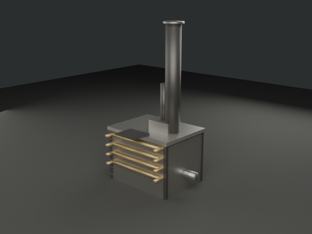
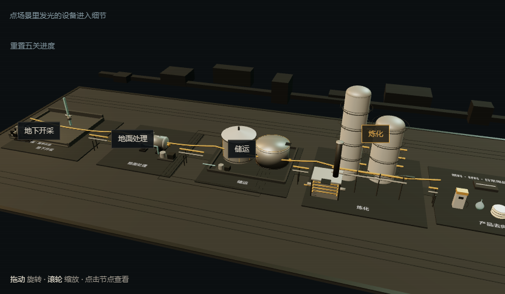
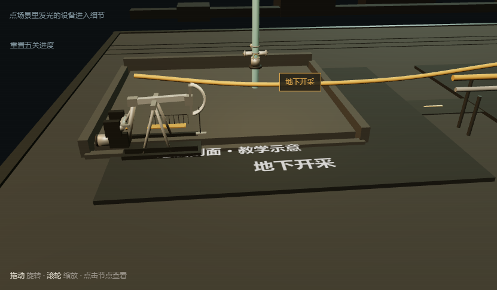
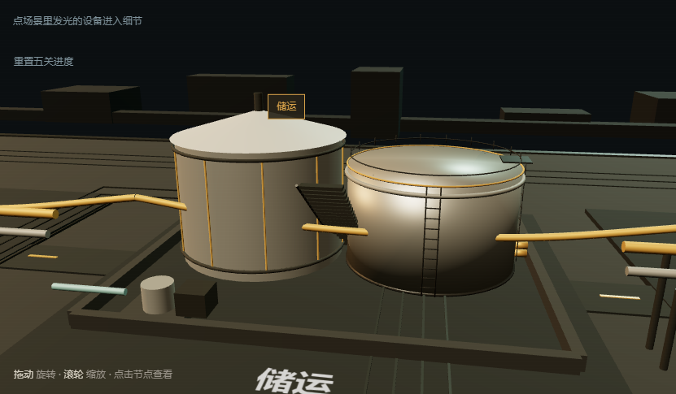
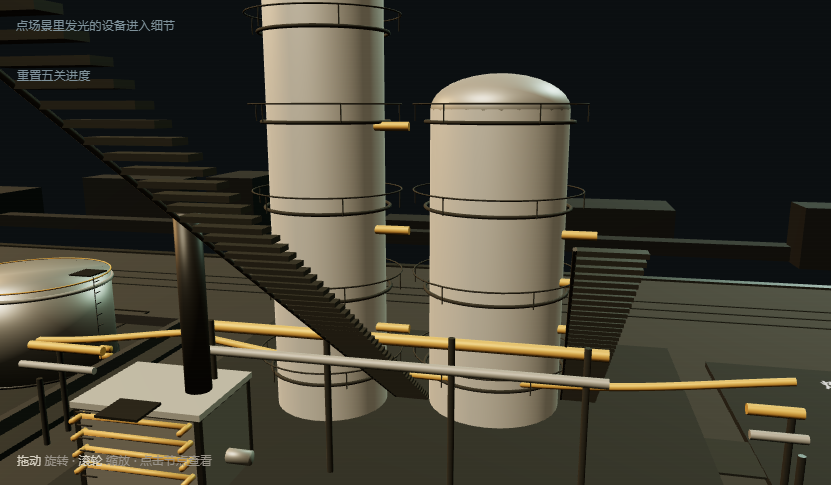

# Hero 资产 v1（Blender → OBJ/MTL）

日期：2026-11-22 · 生成脚本：`tools/make_hero_assets.py` · 输出：`web/assets/hero/<id>/`

目标：把沙盘里五台关键设备从 Three.js 程序化几何升级为 Blender 中模，按材质合并、控制 draw call，先用 OBJ 管线（不引新 loader）。

## 1. 资产清单（实测）

| 资产 | 三角面 | 合并后对象 | 材质 | OBJ | 预算 | 状态 |
|---|---|---|---|---|---|---|
三相分离器 `separator` | 8,236 | 5 | 5 | 452 KB | ≤12k / ≤8 calls | **接受 v1** |
抽油机 `pumpjack` | 1,208 | 4 | 4 | 66 KB | ≤10k / ≤6 calls | **需美术复审**（细节偏少） |
井口采油树 `wellhead` | 3,948 | 4 | 4 | 201 KB | ≤8k / ≤6 calls | **接受 v1** |
外浮顶罐 `floating_roof_tank` | 5,448 | 4 | 4 | 310 KB | ≤10k / ≤6 calls | **接受 v1** |
加热炉 `heater` | 1,364 | 4 | 4 | 65 KB | ≤8k / ≤6 calls | **需重做结构**（太像箱子） |

合计 26 个文件、2.69 MB（含 5 张 Cycles 预览）。全部在面数预算内，但“预算内”不等于质量达标。

## 2. 每个资产包含什么

- `separator`：筒体 + 椭圆封头 + 鞍座/底座 + 进出口/法兰 + 人孔 + 压力表 + 阀轮 + 梯档；锚点 inlet/outlet/gas/water。
- `pumpjack`：底座、A 架、游梁、驴头（弧形板 + 背板）、曲柄/配重、电机、桥式拉杆、走道；锚点 horsehead/beam/crank/motor。
- `wellhead`：底法兰、套管头、主阀、翼阀（两侧）、压力表、手轮；锚点 top/wing。
- `floating_roof_tank`：罐壁、罐底、浮盘/密封圈、导向杆、风圈、顶部平台、直梯、进出料、防火堤；锚点 deck/rim/inlet。
- `heater`：炉体、炉顶、烟囱、燃烧器、炉管（外露）、进出口集箱、平台、梯档；锚点 stack/outlet/burner。

每个目录还带：

```
<id>.obj / <id>.mtl      合并后的网格与材质
<id>.meta.json           尺寸、三角面、对象数、材质数、锚点、预算
<id>.stats.json          同上（工具读）
preview.png              Cycles CPU 预览（640×480，非应用内截图）
```

`web/assets/hero/index.json` 汇总五台资产。**未生成 .blend**（脚本即源，避免仓库膨胀；需要时用脚本重建）。

## 3. 预览

| 资产 | 预览 |
|---|---|
分离器 |  |
抽油机 |  |
井口 |  |
外浮顶罐 |  |
加热炉 |  |

预览暴露的问题（不掩盖）：

- 分离器封头比例已收，但鞍座仍是方块，缺加强筋/地脚螺栓；
- 抽油机驴头已连上游梁，但整机太“骨架”，缺平台、护栏、管线、铭牌；
- 加热炉仍像“箱子 + 烟囱”，炉管外露是教学取舍，但缺炉门、看火窗、风道；
- 井口/储罐在预览里材质偏亮，钢件对比度不足（预览灯光问题，不是资产问题）。

## 4. 材质与命名约定

材质名固定为 `Steel / LightSteel / DarkSteel / Amber / Gauge`，便于运行时映射到 `tokens.css`：

| 材质 | 用途 | 运行时建议 |
|---|---|---|
Steel | 筒体、塔体、主要钢结构 | `#9b968a`，metalness 0.8，roughness 0.42 |
LightSteel | 封头、游梁、平台 | `#cfc8ba`，metalness 0.7，roughness 0.4 |
DarkSteel | 鞍座、底座、栏杆 | `#3a3830`，metalness 0.6，roughness 0.6 |
Amber | 管线、阀轮、浮盘密封 | `#d8a24a`，metalness 0.4，roughness 0.45 |
Gauge | 表盘 | `#e8e1d4`，metalness 0.1，roughness 0.3 |

对象名格式：`<assetId>__<material>`，一个材质一个对象，直接对应一次 draw call。

## 5. 接入进度：五台全部接入（2026-11-22）

五台资产已全部通过共享 `obj-lite.js` 接入沙盘，加载失败时保留程序化模型回退：

| 资产 | 容器位置 | 缩放 | 接入后 |
|---|---|---|---|
separator | gather (0.2,0,0) | 0.88 | 5 mesh，点击弹「三相分离器」 |
pumpjack | drill (-4.6,0.16,3.2) | 0.55 | 4 mesh，点击弹「抽油机」 |
wellhead | drill (-0.6,1.4,-2.2) | 0.50 | 4 mesh，点击弹「井口采油树」 |
floating_roof_tank | store (2.4,-1.6) | 0.46 | 4 mesh，点击弹「外浮顶储罐」 |
heater | refine (-4.6,0,3.6) | 0.80 | 4 mesh，点击弹「加热炉」 |

- 材质对象名 `<asset>__<material>`，每个 mesh 写入 `objectId`，点击优先于关卡 hook；
- 实测 OBJ 8 ms / MTL 5 ms（本机），五台合计 20 个 mesh；
- 设备卡片：`showDevice(id)` 五台名称全部正确。






### 收尾修正（2026-11-22）

- 储罐正面直梯坐标取反，正面可见；
- 泵撬青色转输线缩短，不再横穿分离器筒体；
- 新增 `__stage.stats()`；
- **静态合批**：按材质外观（颜色/金属度/粗糙度/透明/自发光）把程序化杆件、栏杆、梯档、管架合并为每个区域 5–8 个 mesh；分区内的 hero 容器标记 `skipMerge`，避免与异步替换冲突；
- 总览 draw calls **348 → 104**（约 -70%，管线与场景静态件也合并），三角面 49k → 50k 基本不变；
- **真实 Chrome（headed，CDP）实测**：AMD Radeon 集显、DPR 2、105 calls / 50,534 面 → **90 fps**，p50 11.1 ms，p95 11.3 ms，4 秒内 0 个 >33 ms 长帧；首次采样 39.9 fps 是启动/着色器预热，稳定后 90 fps。复现脚本 `tools/fps-probe.cjs`（需先以 `--remote-debugging-port=9333` 启动 Chrome）。

### 上一轮收尾（2026-11-22）

- 储罐加正面直梯、顶部护栏；加热炉加正面双门、外置燃烧器、顶部风道与副烟囱；储罐面数 5,400 → 6,976，加热炉 1,364 → 1,492；
- 炼化近景机位重设（targetY 2.6 / radius 18 / 前移 1.6），加热炉进入画面左侧；
- 地下开采机位改动后看不到剖面，**已回退原机位**，抽油机仍不在近景中心；
- 储罐正面直梯在导出后落在背面，正面仍偏“素”（坐标换算问题，待修）。

### 已知问题（不掩盖）

- 管线仍按程序化法兰位置，接入后**进出口未完全对齐**；
- 分离器前方一根青色管线遮挡筒体；
- 储罐正面细节不足（直梯在背面），加热炉细节仍偏少；
- 地下开采近景以剖面为主，抽油机/井口不在画面中心；
- 没有 LOD，远景仍是全量网格。

## 6. 接入其余四台的前置工作（已过时，保留作记录）

1. **共享 OBJ 解析器**：塔页的 `parseOBJ` 目前内嵌在 `tower.js`，需要抽成 `assets/obj-lite.js` 或用本地化的 `OBJLoader`，否则每个页面复制一份解析器。
2. **材质映射**：OBJ 的 MTL 颜色 → `MeshStandardMaterial` → tokens 色值；现在是 Blender 里的颜色，接入时要统一。
3. **锚点注册**：`.meta.json` 的 anchors 要写进 `DEVICE_INFO`/`__sceneContext`，设备卡片与 AI 才知道每台设备的进料/出口。
4. **LOD 与合并**：OBJ 已经是按材质合并；还需要远/中/近三档或至少一个低模替代。
5. **摆放与朝向**：OBJ 导出为 Y-up、`-Z` 前向；接入时要按沙盘区域旋转、缩放、落地（现在脚本建模是 Z-up、米制）。

在这些完成前，沙盘仍使用程序化几何，不会出现“资产已上线”的假象。

## 7. 复现

```bash
blender -b -P tools/make_hero_assets.py -- --render
```

无 `--render` 时只导出 OBJ/MTL/meta/stats，不跑 Cycles。


## 常减压装置接入（2026-11-22）

- 把 `assets/tower/tower.obj`（常压塔 + 减压塔 + 塔盘/平台/梯子/管线，54 个对象）接入炼化区，替换程序化双塔；剔除 Ground、Heater、Pump、Condenser、产品箱，避免与已有 hero 加热炉/产品重复；
- 缩放到 0.46、常压塔对准原程序化塔位；
- 新增「半剖」按钮：整壳/半壳两组按开关切换，塔盘常显；实测炼化视角 87 calls / 49,270 面，剖开后塔盘与内件可见；
- 新增「自动旋转」按钮：总览缓慢环绕，和原有管线粒子一起让画面持续运动；
- 总览 105 → 147 calls / 67,230 面（装置本体对象未合批，按对象保留以便半剖切换）。

## 抽油机运动（2026-11-22）

- Blender 导出由“按材质合并 4 个 mesh”改为“按功能合并 3 个 mesh”：`pumpjack_static / pumpjack_beam / pumpjack_crank`；
- 浏览器端按前缀拆成 static、beam（绕游梁支点摆动 ±0.05 rad）、crank（绕曲柄轴连续旋转）三组，抽油机在总览和地下开采视角持续工作；
- 地下开采相机从 radius 13 / targetY -1.7 调到 radius 17 / targetY -0.5，抽油机与井口不再被裁切。
