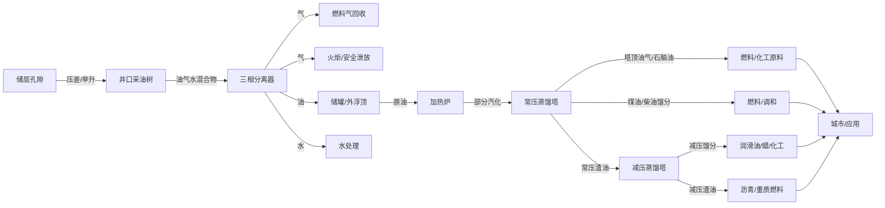

# Phase 02 · 场景地图与空间构图

日期：2026-11-22
性质：**产业链概念数字沙盘**，不是真实地理比例图，也不是同一座真实厂区。必须在页面上标注“产业链空间示意 / 非真实地理比例”。

## 1. 六个视觉区域，五个既有 stage

为兼容现有深链 `#stage=0..4`、五关和 13 个 objectId，**保留五个 stage ID**，把“地下”和“油田地面”拆成两个视觉区域，共六个 zone：

| zone | 视觉名称 | stageId（兼容） | 视觉性格 | 高程 |
|---|---|---|---|---|
| `subsurface` | 地下地质区 | `drill` | 岩层剖面、储层孔隙、井筒、暗而暖的地下光 | y −12…0 |
| `oilfield` | 油田生产区 | `drill` | 盐碱地/荒坡、抽油机群、井口、风 | y 0…3 |
| `gathering` | 集输处理区 | `gather` | 低洼集输站、分离器、管汇、泵撬、蒸汽 | y 0…4 |
| `storage` | 储运区 | `store` | 罐区台地、防火堤、浮顶罐、铁路/公路装车臂 | y 0…5 |
| `refining` | 炼化区 | `refine` | 远处高地装置群、塔器天际线、加热炉、火炬/蒸汽 | y 2…14 |
| `city` | 产品应用区 | `use` | 城市街区、加油站、材料/路面/日用产品、清晨日光 | y 0…6 |

`subsurface` 与 `oilfield` 共用 `drill` 的深链和关卡：进入 `#stage=0` 先到地下剖面，再沿井筒升到油田地面；不新增 `#stage=5`。

## 2. 空间构图（目标，不等同当前坐标）

原则：**不是五个框横向排队**。用一条 S 形产业链走廊，前中远景、左右转折、上下高差同时存在。

```
                        远景：炼化高地（塔器天际线，雾中）
                    ┌──────────────────────────────┐
          z=-22     │   refining plateau  y=2..14   │
                    │   常压塔/减压塔/加热炉/火炬     │
                    └───────────────┬──────────────┘
                                    │ 管廊/蒸汽（向上转折）
              z=-12      ┌──────────┴─────────┐
                         │  storage terrace   │  ← 北侧台地，防火堤
                         │  固定顶/外浮顶罐    │
                         └──────────┬─────────┘
                                    │ 油品管廊（向下转折）
   z=-2     ┌──────────────┐        │
            │  gathering   │────────┘
            │  分离器/管汇  │  ← 中景低洼集输站
            └──────┬───────┘
                   │ 油气水管线（分三路）
   z=8    ┌────────┴────────┐              ┌──────────────────┐
          │  oilfield       │              │  city            │
          │  抽油机/井口群   │──────────────│  加油站/材料/路面 │
          └────────┬────────┘   产品/物流   └──────────────────┘
                   │ 井筒（垂直）
   z=12   ┌────────┴────────┐
          │  subsurface     │  ← 前景左侧下沉剖面
          │  岩层/储层/井筒  │     可看进地层
          └─────────────────┘

  前景：城市街区 + 地下剖面（近）   中景：集输/罐区   远景：炼化高地
```

- **前景（近）**：城市街区、地下剖面切口；用户第一眼有“可进入”的实体。
- **中景**：集输站低洼、罐区台地；形成左右错位。
- **远景**：炼化高地与塔群剪影；用雾、蒸汽、火炬（低饱和）建立天际线，不靠霓虹。
- **视觉焦点**：炼化高地 + 城市清晨光；批次牌是移动的次焦点。
- **转折**：管线从集输向北抬升到罐区，再向东北进入炼化高地；产品从炼化向南回落城市。不是一条直线。
- **高差**：地下 −12m、集输 0–4m、罐区台地 +2m、炼化高地 +2–14m、城市 0–6m。

### 兼容当前坐标的迁移约束

当前 `REGIONS` 是 x=-26/-11/4/19/33 的直线布局。阶段 03 迁移时：

- 保留 `drill/gather/store/refine/use` 五个 stage ID 和 `REGIONS` 锚点语义；
- 新增 `subsurface` 视觉组，但 `stageId` 仍映射 `drill`；
- 13 个 objectId 不变；
- 五关仍按 `modelGroups[index].position` 取锚点；迁移时同步更新关卡锚点；
- `#stage=N`、章节回链、塔页回链不需要改协议。

## 3. 流程关系



说明：

- 气出口“回收/火炬”是两条都存在的现场路径，具体选择取决于工况与安全设计；本设计不估算排放量。
- 馏分不等于成品油；图中“燃料/化工原料”是方向，不是固定收率。
- 城市产品包含燃料、材料、沥青等；塑料也可能来自天然气、煤基或生物基原料。

## 4. 六个区域的视觉与设备清单

| zone | 地面/地貌 | 主设备 | 辅助设备 | 远景/氛围 | 灯光 |
|---|---|---|---|---|---|
| subsurface | 下沉岩层切口，层理清晰，储层有油点 | 井筒、套管、井口底部 | 岩芯、地层标注、孔隙放大 | 地下暗部、岩层暖边 | 低位暖光，冷色反射 |
| oilfield | 盐碱土坡、碎石、浅水洼 | 抽油机 2–3 台、井口 2 个 | 集输支线、围栏、风向袋 | 远处地平线/风 | 清晨侧光，长阴影 |
| gathering | 低洼站场、混凝土基座 | 三相分离器、管汇、泵撬 | 缓冲罐、阀组、蒸汽管 | 蒸汽、低洼雾 | 冷白作业灯 + 暖管 |
| storage | 抬高台地、防火堤 | 固定顶罐、外浮顶罐各 1–2 | 装车臂、泵、消防设施 | 罐顶天际线 | 上午侧光，金属反射 |
| refining | 高地平台、钢构 | 常压塔、减压塔、加热炉 | 管廊、空冷器、火炬、蒸汽 | 塔群剪影、蒸汽 | 逆光/边缘光，控制眩光 |
| city | 城市街区、道路、加油站 | 加油机、材料/产品台 | 路灯、公交站、建筑体块 | 城市清晨、远处楼群 | 日光渐亮，暖窗光 |

## 5. 流程可读性规则

1. 主路线始终可见：一条低饱和的工艺线（不是发光管道），在转折处有方向箭头/批次牌位置。
2. 同屏最多 3 个区域标签；非当前区域标签降透明度，不遮挡设备。
3. 设备标签只在悬停/选中/聚焦时出现；默认不铺满。
4. 相机预设必须能同时看到“当前设备 + 下一段路线”，避免用户失去方向。
5. 关卡内仍使用局部场景，但退出后路线和批次章保留在总览。

## 6. 概念边界声明（页面必须出现）

> 产业链空间示意 · 非真实地理比例 · 设备与工艺为教学简化，不是工程仿真或真实生产数据。

该声明放在场景标题栏或“关于本页”，不遮挡设备；导览第一步也要口播/文字说明一次。

## 7. 与阶段 01 审计的对应

| 审计事实 | 本设计回应 |
|---|---|
| 当前五区沿 x 轴直线排列 | 改成 S 形 + 高差 + 前后景；保留 stage ID |
| 地下只是下沉台阶，没有连续空间 | 新增 `subsurface` 视觉区，阶段 04 新建 Hero |
| 分离器无内部剖切 | 体验 2 明确“剖开”动作，阶段 05 补内部 |
| 塔全剖与半剖几乎一样 | 体验 3 定义全剖必须显示塔板/降液管/侧线/汽液粒子，阶段 06 硬验收 |
| 产品区静态陈列 | 城市区加入交付路线/材料应用，阶段 06 实现 |
| 13 设备只有观察 | 批次任务给设备挂“决策点”，阶段 05/06 实现 |
