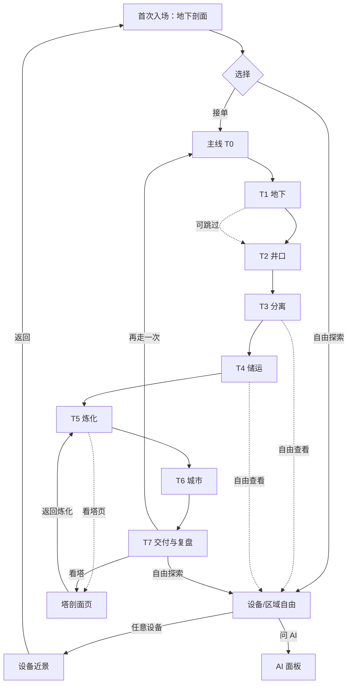
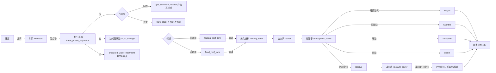

# Phase 02 · 场景地图与空间构图（返修版）

日期：2026-11-22
性质：**产业链概念数字沙盘**，不是真实地理比例图，也不是同一真实厂区。页面必须标注“产业链空间示意 / 非真实地理比例”。
本版修正审查 P0-03（三层地图/构图）、P1-05（分流目的地）与核心主题二。

## 1. 六个视觉区域，五个既有 stage

为兼容 `#stage=0..4`、五关和 13 个 objectId，**保留五个 stage ID**，拆出六个视觉 zone：

| zoneId | 视觉名称 | stageId | 视觉性格 | 高程 |
|---|---|---|---|---|
| `subsurface` | 地下地质区 | `drill` | 岩层剖面、储层孔隙、井筒、暗而暖的地下光 | y −12…0 |
| `oilfield` | 油田生产区 | `drill` | 盐碱坡地、抽油机群、井口、风 | y 0…3 |
| `gathering` | 集输处理区 | `gather` | 低洼站场、分离器、管汇、蒸汽 | y 0…4 |
| `storage` | 储运区 | `store` | 抬高台地、防火堤、浮顶罐、装车臂 | y 0…5 |
| `refining` | 炼化区 | `refine` | 高地装置群、塔器天际线、加热炉、火炬/蒸汽 | y 2…14 |
| `city` | 产品应用区 | `use` | 城市街区、加油站、材料/路面、清晨日光 | y 0…6 |

`subsurface + oilfield` 共用 `drill` 深链；进入 `#stage=0` 先到地下剖面，再沿井筒升到油田地面；不新增 `#stage=5`。

### 1.1 阶段 03 灰盒坐标表（设计近似值）

世界边界按当前地形约 **78×34**（x −39…39，z −17…17）；以下为设计近似值，阶段 03 按实际地形校准并记录偏差，不得直接当成已实现坐标。

| zoneId | centerX | centerZ | width | depth | elevationRange | primaryObjectAnchors | entry/exitAnchor | connectingPathId |
|---|---|---|---|---|---|---|---|---|
| `subsurface` | −25 | 4 | 14 | 10 | y −12…0 | reservoir(−27,−3,4)、wellbore_top_anchor(−22,0,10) | 南侧 z=9 / `cam_subsurface` | `path_sub_oil` |
| `oilfield` | −21 | 11 | 14 | 8 | y 0…3 | pumpjack(−24,0,12)、pumpjack2(−20,0,13)、wellhead(−22,0,10) | 南侧 z=15 / `cam_wellhead` | `path_oil_gather` |
| `gathering` | −2 | 3 | 12 | 10 | y 0…4 | separator(0,2,3)、gas header(−4,2,7)、water treatment(3,0,6) | 西侧 x=−8 / `cam_separator` | `path_gather_store`、`path_gas`、`path_water` |
| `storage` | 12 | −5 | 12 | 10 | y 0…5 | fixed tank(10,1.6,−5)、floating tank(15,1.6,−4) | 南侧 z=0 / `cam_tank` | `path_store_refine` |
| `refining` | 24 | −11 | 16 | 10 | y 2…14 | atm tower(23,8,−12)、vac tower(27,6,−13)、heater(20,2,−9)、flare(31,7,−15) | 南侧 z=−5 / `cam_tower` | `path_refine_city` |
| `city` | 28 | 9 | 15 | 10 | y 0…6 | fuel dispenser(26,0.7,9)、plastic(29,0.5,11)、fiber(31,0.5,10)、lubricant(31,0.5,7)、asphalt(25,0.3,6)、product table(33,0.5,9) | 西侧 x=20 / `cam_city` | `path_refine_city` |

### 1.2 相机锚点（设计近似）

| anchorId | position (x,y,z) | lookAt (x,y,z) | 用途 |
|---|---|---|---|
| `cam_vista` | (10,12,24) | (0,2,0) | 总览/回顾 |
| `cam_subsurface` | (−24,−1,20) | (−25,−3,8) | HM-1 地下 |
| `cam_wellhead` | (−19,3,17) | (−22,1,10) | 井口/地面（权威 wellhead） |
| `cam_separator` | (−5,3,10) | (0,2,3) | HM-2 分离 |
| `cam_tank` | (11,5,5) | (12,2,−4) | 储运 |
| `cam_tower` | (28,10,1) | (24,8,−11) | HM-3 炼化 |
| `cam_city` | (28,5,16) | (29,2,9) | 城市交付 |

- 以上 anchor 与 §1.1 的 zone 中心/设备锚点配套使用；阶段 03 若调整地形，先更新本表再改代码。
- **objectId 与 anchorId 不同**：`wellhead` 是唯一可交互井口对象，权威坐标 `(-22,0,10)`；`wellbore_top_anchor(-22,0,10)` 是地下剖面/镜头使用的非交互锚点，不是第二个井口对象。二者 X/Z 同轴。
- 旧五区 `REGIONS`（x −26/−11/4/19/33）只作为迁移线索；新坐标不改变 `stageId`、`objectId` 和深链。
- 五个旧 stage 仍为 `drill/gather/store/refine/use`；`subsurface` 与 `oilfield` 共用 `drill`。


## 2. 地图 A：产业链世界总览图

回答“世界由什么构成、各区在哪里、前后景是什么”。

```text
                         远景（雾/逆光）
              ┌──────────────────────────────────┐
              │  refining plateau  y=2..14        │
              │  常压塔/减压塔/加热炉/火炬/管廊    │
              └───────────────┬──────────────────┘
                              │ 管廊/蒸汽（转折 1）
                 ┌────────────┴────────────┐
                 │  storage terrace  +2m    │
                 │  固定顶/外浮顶罐/装车     │
                 └────────────┬────────────┘
                              │ 油品管廊（转折 2）
  中景        ┌───────────────┴───────┐
              │  gathering 低洼站场     │
              │  分离器/管汇/泵撬       │
              └───────┬────────┬───────┘
                      │        │（气/水支线）
  近景     ┌──────────┴───┐  ┌─┴──────────────┐
           │  oilfield     │  │  city           │
           │  抽油机/井口   │  │  街区/加油站/材料│
           └──────┬────────┘  └────────────────┘
                  │ 井筒（垂直）
           ┌──────┴────────┐
           │  subsurface   │  ← 前景左侧下沉切口
           │  岩层/储层/井筒│
           └───────────────┘

前景：城市街区 + 地下剖面（近）   中景：集输/罐区   远景：炼化高地
```

### 构图规则

- **前景**：城市街区、地下剖面切口；第一眼有“可进入”的实体。
- **中景**：集输低洼、罐区台地；左右错位，形成转折。
- **远景**：炼化高地与塔群剪影；雾、蒸汽、低饱和火炬建立天际线。
- **视觉焦点**：炼化高地 + 城市清晨光；批次牌是移动次焦点。
- **转折**：集输向北抬升到罐区，再向东北进入炼化高地；产品向南回落城市。不是一条直线。
- **高差**：地下 −12m、集输 0–4m、罐区 +2m、炼化 +2–14m、城市 0–6m。
- **可识别尺度**：三个 Hero 设备在各自区域中占画面 25–45%；远景色块不抢主体。
- **可进入/仅远景**：地下剖面、分离器、储罐、塔体可进入；火炬、远景楼群、水处理池是**不可进入的路径终点/背景**。

## 3. 地图 B：用户探索路径图

回答“用户怎么走、能去哪里、如何返回”。



- 沉浸导览：A → 主线镜头 → 每站可暂停/跳过/接管 → 回全景观测。
- 自由探索：A/D → 任意设备近景 → 返回总览；不强制主线。
- 任务探索：C → E–J → K；可跳过段、可返回自由探索、可看塔页再回来。
- 每个设备近景必须提供“返回总览”和“上一区域/下一区域”路径；返回时保持方向感（回到同一区域锚点，不随机复位）。

## 4. 地图 C：设备与工艺连接图

回答“设备在教学工艺上如何关联、对象 ID 与路径终点是什么”。



### 目的地与对象注册表

| ID | 类型 | zone | 视觉落点 | 可交互 | 责任阶段 |
|---|---|---|---|---|---|
| `three_phase_separator` | 设备 | gathering | 卧式分离器 | 是 | 05 |
| `gas_recovery_header` | 抽象路径终点 | gathering | 北侧燃料气管汇/小阀站，管线汇入 | 否 | 05 |
| `flare_stack` | 远景/背景 | refining | 高地边缘火炬塔，受控火焰仅在选择火炬时 | 否 | 06 |
| `produced_water_treatment` | 抽象路径终点 | gathering | 东侧水处理池/罐，管线汇入 | 否 | 05 |
| `oil_to_storage` | 路径 | gathering→storage | 油相管廊/批次牌轨迹 | 否（路径） | 05 |
| `fixed_roof_tank` | 设备 | storage | 固定顶罐 | 是 | 05 |
| `floating_roof_tank` | 设备 | storage | 外浮顶罐 | 是 | 05 |
| `atmospheric_tower` | 设备 | refining | 常压塔 | 是 | 06 |
| `vacuum_tower` | 设备 | refining | 减压塔 | 是 | 06 |
| `heater` | 设备 | refining | 加热炉 | 是 | 06 |
| `city` | 区域 | city | 街区/加油站/材料台 | 区域 | 06 |
| `city_product_table` | 非交互展示台 | city | 产品台，承载石蜡等展示卡 | 否 | 06 |

**规则**：不可交互终点必须有可观察几何/路径，不得只存在于成功条件文本；未确认资产/许可证不得列为可商用。

## 5. 总览构图 vs 首次入场构图

审查指出：城市与地下都做前景会削弱起点/终点叙事。修订：

| 构图 | 使用场景 | 地下 | 城市 | 炼化 | 说明 |
|---|---|---|---|---|---|
| **总览** | 自由探索/回顾/导览结束 | 可见但低对比 | 远景轮廓可见，建立终点认知 | 天际线焦点 | 六区关系可读 |
| **首次入场** | 首屏/T0/T1 | **唯一主焦点**，占画面 50–60% | 降对比/被地形遮挡/只见微光 | 远景色块，不抢焦点 | 起点明确，终点留悬念 |
| **城市揭示** | T6 | 退到背景 | 完整显现、日光 | 退到中景 | 终点获得叙事重量 |

- 首次入场不显示完整城市；T6 才让城市进入高对比，形成“到达”的体验。
- 自由探索允许随时拉远看总览；不强制线性。
- 起始机位与总览机位分开定义（见 `camera-storyboard.md`）。

## 6. 垂直关系与空间连续性

- 地下剖面从南侧开口看入，层理水平，井筒垂直；唯一可交互井口 `wellhead` 在 `(-22,0,10)`，剖面用 `wellbore_top_anchor(-22,0,10)` 表示同轴顶部，镜头沿该轴上升不穿模。
- 对象注册表只实例化一个 `wellhead`；`wellbore_top_anchor` 只出现在锚点/相机数据，不参与射线拾取、设备卡或 AI objectId。
- 管线/管廊/地形连接：集输→储运用抬升管廊；储运→炼化用坡道/管架；炼化→城市用产品管线顺坡下降。
- 区域间用“工艺脊线”（管架 + 地面物流带 + 批次教学轨迹）连接，不是厂区道路。
- 道路只在城市区出现，避免把产业链伪装成同一厂区路网。
- 远景用低模楼群/塔群/地形轮廓，不布置可交互设备。

## 7. 标签、热点与遮挡

- 同屏最多 3 个区域标签；非当前区域透明度 0.35。
- 设备标签只在悬停/选中/聚焦出现；当前设备引线 ≤40px。
- 热点不放在设备正前方遮挡结构；优先侧面/上方。
- 设备近景时隐藏其他区域标签；返回总览再显示。
- 批次牌沿管线外侧，不遮住设备铭牌/出口。

## 8. 与现有工程的迁移约束

- 保留 `drill/gather/store/refine/use` 五个 stage ID 与 `#stage=N` 深链。
- 新增 `zoneId='subsurface'|'oilfield'|...`，旧 `stageId` 不变；`subsurface/oilfield` 都映射 `drill`。
- 13 个 objectId 不变；新增 `gas_recovery_header`、`flare_stack`、`produced_water_treatment` 为路径终点/远景，不强行做成可交互设备。
- 五关按 `modelGroups[index].position` 取锚点；迁移时同步更新关卡锚点，避免五关错位。
- 相机锚点命名统一 `cam_*`（详见镜头脚本），不把坐标散落在多个文件。

## 9. 验收

- 三张图可读，能追踪 T0–T7 完整主线；
- 每个任务目标对应地图上的区域/设备/路径终点；
- 六区不呈直线排列，有前中远景、转折、高差；
- 首次入场与总览构图分离，城市在 T6 才完整显现；
- 所有可交互设备有稳定 objectId；不可交互终点有明确视觉落点；
- 页面标注“产业链空间示意 / 非真实地理比例”。
