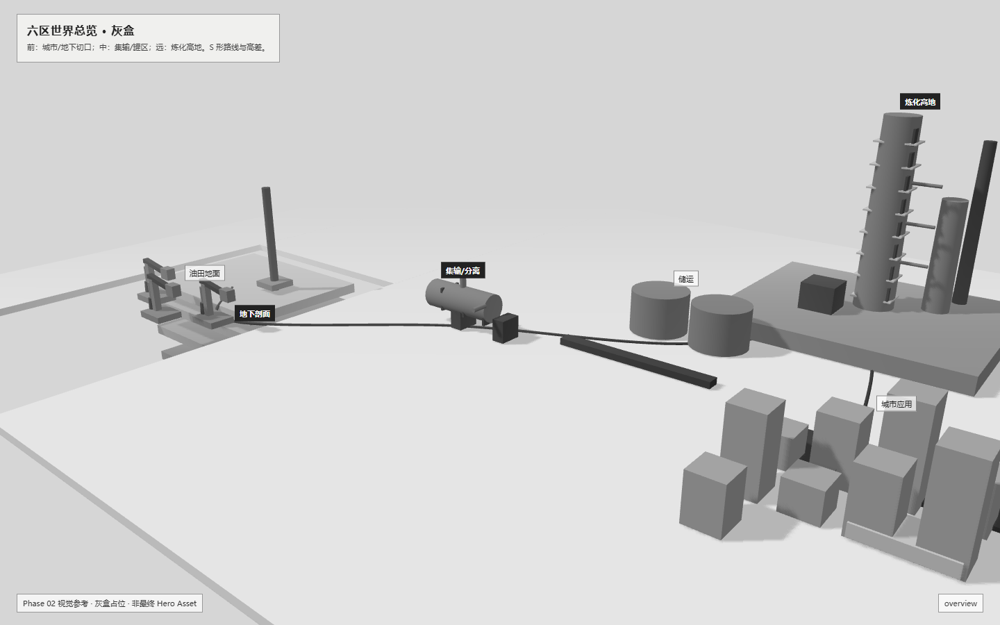
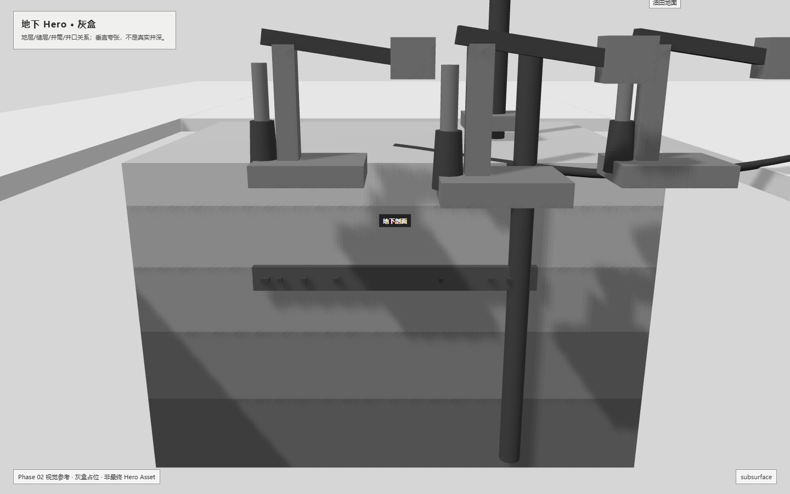
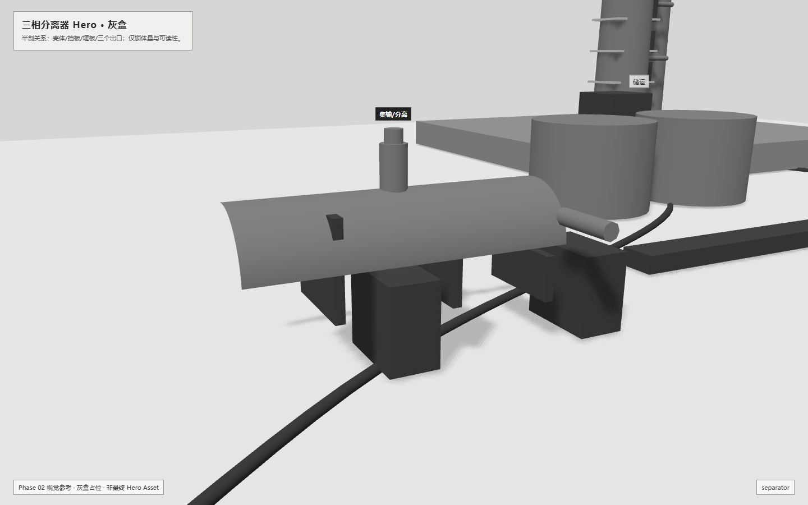
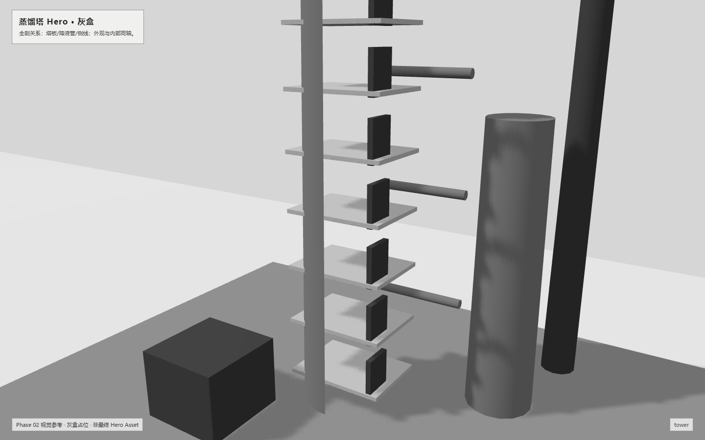

# Phase 02 · 视觉艺术指导与视觉参考（返修版）

日期：2026-11-22
关键词：**地下夜色 → 井场清晨 → 城市日光**；暖砂岩、旧钢、黄铜批次牌；工业真实感靠结构、磨损和光，不靠霓虹。
本版修正审查 10.1（视觉参考/UI 层级）、P1-07（Token 单一来源）、P1-08（性能预算）、核心主题二构图。

## 1. 视觉主张

不是“深色背景 + 发光管线 + 粒子 + 卡片”的科技展台，而是**一条被切开、被阳光扫过的产业链地貌**：

- 地下低照度暖褐岩层，只有岩芯/储层油点/井筒有局部光；
- 地面清晨长阴影，钢构件有旧漆、锈迹、螺栓、护栏；
- 炼化高地逆光剪影，蒸汽/火炬提供动态，不做满屏辉光；
- 城市日光下的真实材料：沥青、混凝土、玻璃、塑料、金属；
- 黄铜批次牌是唯一“贵重物”，用金属反射和盖章动作建立记忆点。

## 2. 色彩

保留现有暖墨/赭黄/灰青骨架，扩大自然材质色，降低发光色占比。

| 角色 | 色值 | 用途 |
|---|---|---|
| 暖墨底 | `#14110d` | 背景/阴影，不用纯黑 |
| 砂岩 | `#c9b08a` | 地面、岩层暖面 |
| 石灰岩 | `#d8cbb5` | 地下层理、城市立面 |
| 旧钢 | `#6f6a5f` | 塔器、管架、罐壁 |
| 深钢 | `#3b3831` | 结构、阴影面 |
| 锈 | `#8a5a3a` | 法兰、梯子、边缘磨损 |
| 黄铜 | `#b8893f` | 批次牌、可交互边缘 |
| 品牌赭黄 | `#d8a24a` | 主 CTA/当前章，少量 |
| 灰青 | `#5f8c86` | 气相/水/技术线 |
| 水 | `#4f7d8c` | 水出口/处理 |
| 气 | `#b8c9c4` | 气相（低饱和，不发光） |
| 警示 | `#c4703f` | 错误/火炬/安全 |
| 城市日光 | `#e3c79b` | 城市暖窗/清晨光 |

### 分区色温

| zone | 主色 | 光比 | 备注 |
|---|---|---|---|
| subsurface | 暖褐+深灰 | 高对比、局部光 | 层理有明暗，不纯黑 |
| oilfield | 砂岩+旧钢 | 清晨长影 | 风、尘、盐碱地 |
| gathering | 冷混凝土+灰青管 | 中等 | 蒸汽柔光 |
| storage | 浅钢+赭黄边 | 金属反射 | 防火堤/罐顶几何 |
| refining | 深钢剪影+逆光 | 高对比 | 火炬/蒸汽唯一强动态 |
| city | 日光暖灰+玻璃 | 低对比、明亮 | 避免夜景霓虹 |

## 3. 材质与灯光

- 旧钢：粗糙度 0.45–0.65、金属度 0.5–0.8，边缘轻锈；禁止全镜面/荧光描边。
- 涂装钢：低饱和灰绿/米白，局部掉漆；禁止大面积高饱和纯色。
- 混凝土：粗糙 0.9，色差/污渍；禁止纯白平板。
- 岩层：分层色带+颗粒噪声，层理明确；禁止整块黑。
- 玻璃/塑料：透明/半透、菲涅尔；不发光。
- 沥青：深灰、粗糙、轻微反光；不镜面黑。
- 黄铜：金属度高、暖反射；只用于批次牌/当前可交互。

灯光：1 主光（低角度暖 key）+ 1 半球光（冷灰青 fill）+ 少量无阴影实用光；轮廓光只给塔器边缘；不做全屏 bloom。时间弧从地下暖低照度 → 井场清晨 → 集输冷白 → 储运上午 → 炼化逆光 → 城市日光。

## 4. 六张视觉参考（低保真，不是最终资产）

> 以下为**构图/层级参考**，用于讨论与签收；不得当作已完成的网页截图或 3D 资产。

### 参考 1：首次进入（地下主焦点）

```text
┌────────────────────────────────────────────┐
│ [退出]                          [声音 更多] │
│                                            │
│         ╔══════ 岩层剖面 ══════╗             │
│         ║ 覆盖层 / 盖层         ║  抽油机剪影  │
│         ║ 储层 ● 油点  ●       ║   （上方）   │
│         ║ 井筒 │               ║             │
│         ╚════╪════════════════╝             │
│              │ 批次牌（黄铜）                 │
│                                            │
│  [接收批次]        ●●●○○○                  │
└────────────────────────────────────────────┘
```

- 城市不出现/极低对比；地下剖面占 50–60%；批次牌是次焦点。
- UI：底部一个 CTA + 6 进度点；不铺标签。

### 参考 2：六区世界总览

```text
┌────────────────────────────────────────────┐
│ 远景：炼化高地塔群/蒸汽/低饱和火炬           │
│      ┌──────────────┐                      │
│      │ refining     │      storage         │
│      └──────┬───────┘    ┌────────┐        │
│             │ 管廊        │ 罐区   │        │
│      ┌──────┴───────┐    └───┬────┘        │
│      │ gathering    │────────┘             │
│      └───┬──────┬───┘                      │
│  ┌───────┴──┐  ┌┴──────────────┐           │
│  │ oilfield │  │ city           │           │
│  └───┬──────┘  └────────────────┘           │
│  ┌───┴──────┐                              │
│  │subsurface│  ← 前景切口                  │
│  └──────────┘                              │
│  产业链空间示意 · 非真实地理比例             │
└────────────────────────────────────────────┘
```

- 前中远景同时存在；S 形转折；区域标签 ≤3。

### 参考 3：地下体验近景

```text
┌────────────────────────────────────────────┐
│  层理带（暖褐/灰绿）                        │
│  ┌──────────────┐   井筒（垂直）            │
│  │ 储层透镜体 ● │   套管/水泥环             │
│  │ 油点 ●  ●    │   井口（上方）            │
│  └──────────────┘                          │
│   [放大储层]  [切换地层]                    │
│   控制值 0—100（压差驱动示意，非真实压力）   │
└────────────────────────────────────────────┘
```

### 参考 4：分离器内部

```text
┌────────────────────────────────────────────┐
│  气出口 ↑          ┌─ 挡板 ─┐              │
│  ═════════════╗    │ 堰板   │  油出口 →     │
│  进口 →       ║    │        │              │
│  ═════════════╝    └────────┘  水出口 ↓     │
│  [半剖/全剖] [启动/暂停] [气:回收|火炬]      │
│  剖切面深色 + 轻边线；三出口文字标注          │
└────────────────────────────────────────────┘
```

### 参考 5：蒸馏塔外观/全剖

```text
外观：                 全剖：
┌────────┐            ┌────────┐
│ 塔顶   │            │ 塔板   │
│ 侧线 → │            │ 降液管 │
│ 进料 → │            │ 侧线 → │
│ 塔底   │            │ 汽/液  │
└────────┘            └────────┘
```

- 全剖必须比半剖多出塔板/降液管/侧线/粒子；不能只切壳。

### 参考 6：知识/任务/AI 面板

```text
┌──────────────────────────────┐
│ 三相分离器        [关闭]      │
│ 用途：把油/气/水按相态分开     │
│ ┌ 结构 ┐ ┌ 过程 ┐ ┌ 知识 ┐   │
│ 半剖/全剖  启动/暂停  读本章   │
│ 问星火：[就这一层问一句…] ↑   │
│ 批次 YJ-001 · 已分离 · 2/5章  │
└──────────────────────────────┘
```

- 面板 360px；不遮挡画面中心；AI 输入在面板底部。

## 5. UI 层级

| 层 | 内容 | 位置/行为 |
|---|---|---|
| L0 全局导航 | 首页/探索/问答/写作 | 顶栏，固定 |
| L1 模式 | 导览/自由/任务 | 场景左上或底栏，低干扰 |
| L2 场景工具 | 总览/聚焦/剖切/流向/设备/更多 | 场景标题栏，一级 ≤5 |
| L3 任务/批次 | 批次号、当前节点、章、提示 | 底部窄条，不遮中心 |
| L4 设备面板 | 名称/用途/结构/过程/知识/AI | 右侧 360 或底部抽屉 |
| L5 知识/来源 | 章节链接、参考资料 | 面板内折叠 |
| L6 系统 | 关于/声明/重置 | 更多菜单或页脚 |

规则：L3 不覆盖设备主体；L4 打开时画布 ≥60%；L0 不抢场景；L5 默认折叠。

## 6. Token 单一来源

`web/assets/site/tokens.css` 是唯一来源；阶段 03 只能扩展 Token，不在页面/组件散落硬编码。

| 设计名 | Token 变量（新增/沿用） | 值 | 用途 |
|---|---|---|---|
| 暖墨底 | `--ink`（沿用） | `#0b0f11` | 页面底 |
| 场景底 | `--scene-bg`（新增） | `#14110d` | 三维背景 |
| 砂岩 | `--sand`（新增） | `#c9b08a` | 地面/岩层 |
| 石灰岩 | `--limestone`（新增） | `#d8cbb5` | 层理/立面 |
| 旧钢 | `--steel`（沿用/调整） | `#6f6a5f` | 设备 |
| 深钢 | `--steel-dark`（新增） | `#3b3831` | 结构阴影 |
| 锈 | `--rust`（新增） | `#8a5a3a` | 磨损 |
| 黄铜 | `--brass`（新增） | `#b8893f` | 批次牌 |
| 品牌赭黄 | `--amber`（沿用） | `#d8a24a` | CTA |
| 灰青 | `--teal`（沿用） | `#5f8c86` | 技术线 |
| 水 | `--water`（新增） | `#4f7d8c` | 水 |
| 气 | `--gas`（新增） | `#b8c9c4` | 气相 |
| 警示 | `--warn`（新增） | `#c4703f` | 错误/火炬 |
| 城市日光 | `--daylight`（新增） | `#e3c79b` | 城市 |

- 沿用现有 `tokens.css` 的暖墨/赭黄/灰青；新增色先补 Token，再使用。
- 现有 `sandbox.html` 内联/脚本硬编码色在阶段 03 逐步替换；不在本阶段修改。

## 7. 整场景性能预算

阶段 01 基线：1440×900、DPR2、AMD 集显，118 calls / 47,634 面 / 89.4 fps；不同状态会有波动。

| 指标 | 目标/上限 | 验证 |
|---|---|---|
| 帧率 | 目标 ≥60 fps，p95 帧时间 ≤16.7ms | 阶段 03/09 CDP |
| draw calls | 总览 ≤220；单区近景 ≤140 | `__stage.stats()` |
| 三角面 | 总览 ≤120k；单区 ≤60k | 同上 |
| 实时阴影灯 | 1 个方向光阴影；范围覆盖当前区 | 灯光审计 |
| 纹理内存 | ≤64MB；单张 ≤2048² | 资产清单 |
| DPR | 上限 1.5；低端可 1.0 | 设备策略 |
| 合批 | 静态件按材质合批；Hero skipMerge | stats |
| 裁剪 | 视锥/距离裁剪；远景 LOD | 代码审查 |
| 非焦点动画 | 降频/暂停；页面隐藏暂停 | 行为测试 |

超预算优先级（从高到低保留）：HM-1 地下、HM-2 分离、HM-3 塔全剖；先降远景/城市细节、粒子数、阴影，不先降三个 Hero。

降级策略：低端设备 DPR1、关闭自动阴影、减少粒子/远景、减少 UI 动效；不白屏、不丢任务。

## 8. 反模式

1. 深色背景 + 全屏发光管线/粒子。
2. 每个设备霓虹描边/悬浮图标。
3. 满屏标签/数据卡遮挡设备。
4. 纯程序化 Box 拼装关键设备。
5. 无磨损/螺栓/护栏的“塑料工业”。
6. 所有区域同一色温/灯光。
7. 视频/静态图替代可操作 3D。
8. 用科技蓝/赛博朋克覆盖石油工业真实材质。

## 9. 验收画面

阶段 09 必须提供真实浏览器截图（非设计稿）：

- 首屏（地下主焦点）；
- 六区总览；
- 分离器内部；
- 塔外观/半剖/全剖；
- 城市交付；
- 三种 UI 密度；
- 知识/任务/AI 面板；
- 无 WebGL fallback。

每张至少 1440×900；1920×1080 加分；移动端本期不承诺。截图需能看出参考 1–6 的构图/层级被实现，而不是只堆设备。

### 4.1 低保真 3D 灰盒参考（Phase 02 证据）

以下四张是**真实浏览器渲染的灰盒 blockout**，使用基础几何体锁定六区体量、S 形路线、高差和三个 Hero 的空间/剖切关系。它们不是最终模型、不是网页实现、不得作为 Hero Asset 验收证据。



- 六区总览：前中远景、S 形路线、炼化高地/罐区/城市/地下切口的关系；地下剖面在左侧切口，城市在右前。
- 生成源：`docs/phase-reports/evidence/phase-02/blockout.html`（Three.js 基础几何体，1440×900，轴测灰模）。



- 地下 Hero：层理、储层带、井筒/井口与地表抽油机的垂直关系；垂直夸张，不是真实井深。
- 该图只锁“可读关系”，不锁最终材质/结构细节。



- 分离器 Hero：半剖壳体、挡板/堰板、三个出口与储罐的相对位置；内部构件只到体量级。
- 阶段 05 必须用正式资产重做，不得拿此图当验收。



- 蒸馏塔 Hero：全剖壳体、塔板/降液管/侧线；外观与内部同轴。
- 阶段 06 必须让全剖与半剖有结构级差异；灰盒仅用于锁定关系。

限制：灰盒由设计用 HTML 渲染，非 Blender/正式资产；灯光、材质、比例均为讨论用。阶段 03 若使用占位资产，必须沿用“占位”标识，不得声称达到阶段 04–06 的资产门禁。

